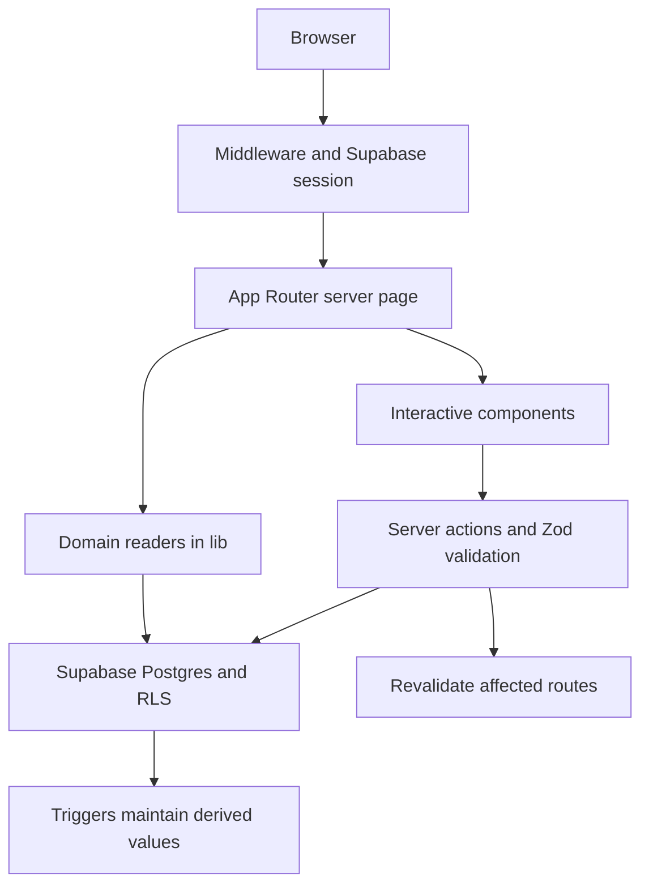

# Repository guide

Reviewed 2026-09-29 at `937468f`. This describes the checkout, not a verified production deployment.

## Product and roles

The product helps EIC run entrepreneurship programs around real team projects. Teams work through missions and deliverables, mentors review the work, jurors evaluate pitches, and GameMasters administer the event.

| Surface | Main routes | Main code |
|---|---|---|
| Entry and account | `/`, `/landing`, `/login`, `/auth/callback`, `/settings` | `lib/auth.ts`, `lib/profile.ts`, `utils/supabase/` |
| Player | `/onboarding`, `/journey`, `/journey/deliverable/[id]`, `/journey/bonus/[type]`, `/journey/help`, `/journey/pitch-prep` | `lib/journey.ts`, `lib/journey-progression.ts`, `lib/bonus.ts`, `lib/help-requests.ts`, related components |
| Mentor | `/mentor`, `/mentor/submission/[id]`, `/mentor/bonus/[id]` | `lib/mentor.ts`, evaluation and comment components |
| Jury and results | `/jury`, `/results`, `/results/ceremony` | `lib/jury.ts`, `lib/jurors.ts`, `lib/pitch-criteria.ts`, `lib/pitch-mode.ts`, `lib/results.ts` |
| GameMaster | `/admin`, `/admin/players/[id]`, `/admin/players/import`, `/admin/deliverables`, `/admin/announce` | `lib/admin*.ts`, `components/admin-*.tsx` |
| Program configuration | `/admin/events`, `/admin/events/[id]/missions`, `/admin/events/[id]/settings`, `/admin/levels` | `lib/admin-events.ts`, `lib/admin-missions.ts`, `lib/admin-levels.ts`, `lib/event-settings.ts` |
| Exports | `/admin/export/players.csv`, `/admin/export/results.csv`, `/api/export/moscow/[deliverableId].csv` | Corresponding `route.ts` files, `lib/csv.ts`, export helpers |

`AppRole` has three values: `player`, `mentor`, `game_master`. Jury access is modeled separately through juror membership; do not add an assumed fourth profile role without inspecting that model.

## Request and data flow

- `middleware.ts` delegates session refresh and route gating to `utils/supabase/middleware.ts`.
- Pages assemble server data from `lib/` and pass it to interactive components. Actions in `app/actions.ts` handle writes, authorization checks, validation and route invalidation.
- `lib/types.ts` defines domain shapes; `lib/schemas.ts` defines shared input validation. Some action-specific schemas remain in `app/actions.ts`.
- `utils/supabase/server.ts` creates the cookie-aware server client; `client.ts` serves browser/realtime use. Privileged provisioning paths use the service-role client and require separate scrutiny.
- Scoring crosses `lib/score.ts`, `lib/results.ts`, event settings, evaluations/pitch scores and PostgreSQL triggers. A change in one layer needs parity checks against the others.

The core relationships are organizations → events → cohorts → players, and events → missions → deliverable templates → submissions → evaluations. Player membership and mentor assignments connect users to teams. Jurors and pitch criteria belong to events. Levels currently use `levels_v2`; do not assume they are independently scoped to every organization/program just because event editing exists.

## Runtime modes

`lib/supabase-status.ts` checks whether both public Supabase variables are present. Missing configuration makes server clients return `null`; individual readers may return seeds, defaults, empty data or no result.

This is a **partial demo contract**. `/journey` deliberately renders an empty account state without a backend; several protected dashboards redirect to login. Existing tests accept some redirects. Full working sample accounts and complete local user journeys are future work.

Production queries must retain authorization and event boundaries. Fallbacks in modules such as `lib/levels.ts` were designed for migration windows; review whether hiding configuration/query failures behind defaults remains appropriate before release.

## Repository layout

| Location | Responsibility |
|---|---|
| `app/` | Routes, server actions, global CSS, tokens, loading/error boundaries |
| `components/` | Role-specific UI, editors, forms, notifications and shared shell |
| `lib/` | Domain readers, calculations, schemas, translation strings and seed data |
| `hooks/` | Autosave and interaction hooks |
| `utils/supabase/` | Browser/server clients and session middleware |
| `supabase/migrations/` | Authoritative future migration history |
| `database/` | Declarative SQL mirrors, historical seeds and manual audit/reset scripts |
| `tests/unit/` | Vitest calculation, schema and clone-remapping tests |
| `tests/smoke/`, `tests/e2e/` | Playwright demo checks; names do not imply authenticated workflow coverage |
| `tests/rls/`, `scripts/` | Manual database checks, provisioning, performance and maintenance utilities |
| `public/` | Static branding and assets |
| `docs/` | Current guides and operator references |
| `.planning/` | Milestone execution, decisions, audits and historical artifacts |
| `ops/` | Alternative Docker/Caddy configuration; not the verified Vercel setup |

`.next/`, `node_modules/`, browser reports and local event deliverables are workspace/runtime artifacts. Keep real participant records and credentials out of commits; existing ignore rules are not proof that every new file is safe to stage.

## Where to improve first

Keep the current stack and evolve the application in small, tested changes. `app/actions.ts` is 3,716 lines and `app/globals.css` is 8,986 lines at this baseline. Split mutation code by domain and CSS by component/surface only after meaningful regression coverage exists. Prefer one extracted boundary at a time over a broad directory rewrite.

Prioritize database reproducibility and authenticated flows before structural refactors. The [audit](REPO_AUDIT.md) explains the evidence; the [roadmap](PRODUCTION_ROADMAP.md) turns it into sequenced work.
